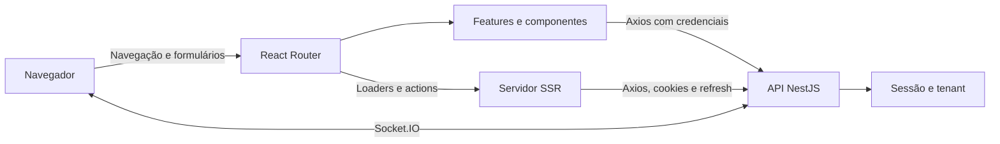

# Finanças Pessoal — Frontend

Interface web para gestão financeira pessoal e multi-tenant, construída com
React e React Router. O frontend apresenta dashboards, despesas, receitas e
cadastros auxiliares, além dos fluxos de autenticação e administração de
tenants, membros e convites.

## Principais recursos

- autenticação, logout, recuperação e redefinição de senha;
- dashboard com resumo anual, séries mensais e gráficos financeiros;
- cadastro e acompanhamento de despesas e receitas;
- importação e revisão de documentos e despesas temporárias;
- gestão de categorias, parcelas, pagamentos e status;
- administração de tenants, membros e convites conforme o papel do usuário;
- renderização no servidor com sessão baseada em cookies HTTP-only;
- renovação automática da sessão após respostas HTTP `401`;
- atualizações em tempo real com Socket.IO;
- interface responsiva em português do Brasil.

## Tecnologias

| Área | Tecnologia |
| --- | --- |
| Aplicação | Node.js 20, TypeScript 5, React 19, React Router 7 |
| Build e SSR | Vite 7, React Router framework mode |
| Interface | Tailwind CSS 4, Radix UI, React Aria Components, Lucide |
| Comunicação | Axios, Socket.IO Client |
| Validação | Zod |
| Tabelas e gráficos | TanStack Table, Recharts, Chart.js |
| Datas | date-fns, Day.js, React DayPicker |
| Qualidade | TypeScript, Biome, Node.js Test Runner |

## Arquitetura

O código separa rotas, regras de apresentação, componentes reutilizáveis e
integrações com a API. Loaders e actions do React Router executam tanto no SSR
quanto nas navegações da aplicação.

```text
app/
├── api/          # clientes Axios do navegador e do servidor
├── auth/         # contexto de cookies e renovação de sessão no SSR
├── components/   # componentes compartilhados e primitives de interface
├── constants/    # constantes dos domínios financeiros
├── contexts/     # contextos React, incluindo Socket.IO
├── feature/      # formulários, tabelas e regras organizadas por recurso
├── hooks/        # hooks reutilizáveis
├── interfaces/   # contratos TypeScript
├── routes/       # loaders, actions e telas das rotas
├── server/       # serviços de acesso à API usados pelas rotas
├── utils/        # formatação, validação e utilitários
├── root.tsx      # layout, sessão e tratamento global de erros
└── routes.ts     # definição central das rotas
```



O loader raiz consulta `/auth/me` antes de renderizar as áreas protegidas. No
servidor, o contexto de cada requisição encaminha os cookies ao backend e
repassa cabeçalhos `Set-Cookie` para o navegador, sem compartilhar estado entre
requisições concorrentes.

## Pré-requisitos

Para executar o frontend diretamente na máquina:

- Node.js 20 ou superior;
- npm;
- backend principal acessível, por padrão em `http://localhost:3333`.

Para executar em contêiner, também é necessário Docker Engine ou Docker
Desktop.

O projeto usa `npm` como gerenciador de pacotes de referência. O Dockerfile
utiliza `npm ci` e `package-lock.json`.

## Início rápido

Entre na pasta do frontend e instale as dependências:

```bash
cd src/financas-pessoal-frontend
npm ci
```

Crie um arquivo `.env` quando precisar alterar o endereço padrão da API:

```dotenv
VITE_API_BASE_URL=http://localhost:3333
```

Inicie o servidor de desenvolvimento:

```bash
npm run dev
```

A aplicação fica disponível em `http://localhost:5173`.

O backend deve permitir essa origem em `FRONTEND_URL` e aceitar credenciais em
CORS e Socket.IO.

## Desenvolvimento local

O servidor de desenvolvimento oferece recarregamento automático. Os demais
modos de execução são:

```bash
# Verificação de tipos
npm run typecheck

# Build de produção
npm run build

# Execução da saída compilada
npm run start
```

O build é criado em:

```text
build/
├── client/  # bundle e arquivos estáticos do navegador
└── server/  # aplicação SSR
```

Por padrão, `npm run start` disponibiliza a aplicação em
`http://localhost:3000`.

## Configuração

| Variável | Finalidade | Padrão local |
| --- | --- | --- |
| `VITE_API_BASE_URL` | Endereço base da API HTTP e do Socket.IO | `http://localhost:3333` |

No navegador, variáveis `VITE_*` são incorporadas ao bundle durante o build. No
servidor SSR, `VITE_API_BASE_URL` também pode ser definida no ambiente do
processo em execução.

O mesmo endereço precisa ser alcançável pelo navegador e pelo servidor SSR. Em
ambientes com proxy ou rede de contêineres, configure uma URL pública no build
do cliente e, quando necessário, uma URL interna no processo SSR.

Nunca armazene segredos no frontend. Variáveis prefixadas com `VITE_` podem ser
expostas no bundle enviado ao navegador.

## Build com Docker

A partir da pasta do frontend, crie e execute a imagem:

```bash
docker build -t financas-pessoal-frontend .
docker run --rm -p 3000:3000 financas-pessoal-frontend
```

Defina `VITE_API_BASE_URL` em `.env.production` antes de criar a imagem quando o
bundle do navegador precisar apontar para outra URL.

Se o servidor SSR precisar usar um endereço interno diferente, informe-o ao
iniciar o contêiner:

```bash
docker run --rm -p 3000:3000 \
  -e VITE_API_BASE_URL=http://api:3333 \
  financas-pessoal-frontend
```

## Autenticação, autorização e tenants

O backend mantém access e refresh tokens em cookies HTTP-only. Os clientes
Axios do frontend usam `withCredentials: true` para enviar esses cookies.

Quando uma requisição recebe `401`, o frontend tenta uma única renovação em
`/auth/refresh` e repete a requisição original. Login, recuperação de senha,
redefinição de senha e aceite de convite permanecem públicos; as demais telas
validam a sessão por meio de `/auth/me`.

A navegação e as ações administrativas consideram os papéis `SUPER_ADMIN`,
`ADMIN` e `MEMBER`. O backend continua sendo responsável pela autorização e
pelo isolamento definitivo entre tenants.

## Principais grupos de rotas

| Prefixo | Responsabilidade |
| --- | --- |
| `/login`, `/logout` | Entrada e encerramento da sessão |
| `/recuperar-senha`, `/reset-password` | Recuperação e redefinição de senha |
| `/aceitar-convite` | Aceite de convite para um tenant |
| `/home` | Dashboard financeiro |
| `/despesas` | Despesas, documentos e lançamentos temporários |
| `/receitas` | Receitas e consolidações por período |
| `/categorias` | Categorias financeiras |
| `/pagamentos` | Formas e estados de pagamento |
| `/parcelas` | Parcelas |
| `/status` | Status financeiros |
| `/admin/tenants` | Administração de tenants |
| `/admin/membros`, `/admin/convites` | Membros e convites |

A rota raiz redireciona para `/home`. Rotas de criação, edição, exclusão e
alteração de status são declaradas centralmente em `app/routes.ts`.

## Testes e qualidade

| Comando | Descrição |
| --- | --- |
| `npm run typecheck` | Gera os tipos das rotas e verifica o TypeScript |
| `npm run build` | Gera os bundles do cliente e do servidor SSR |
| `npx biome check .` | Verifica formatação, imports e regras do Biome |
| `node --test` | Executa os testes existentes com o test runner do Node.js |

Antes de enviar alterações, execute pelo menos a verificação de tipos, o build
e o Biome. Testes de rotas substituem as integrações HTTP para não criar dados
reais no backend.

## Convenções de desenvolvimento

- use o alias `@/` para importar módulos dentro de `app/`;
- mantenha loaders e actions nos módulos de rota;
- concentre o acesso HTTP em `app/server` ou `app/api`;
- organize código específico de domínio em `app/feature/<recurso>`;
- preserve o TypeScript em modo estrito e valide formulários com Zod;
- trate estados de carregamento, erro, vazio e permissão como parte do fluxo.

## Solução de problemas

### A aplicação não conecta à API

Confirme se o backend está disponível no endereço definido por
`VITE_API_BASE_URL`. Verifique também se `FRONTEND_URL` no backend corresponde à
origem do frontend e se CORS aceita credenciais.

### O login funciona, mas a sessão não é mantida

Verifique as políticas de cookies do navegador, o domínio configurado no
backend e o uso de HTTPS em produção. Frontend e backend precisam concordar
sobre origem, domínio e credenciais.

### Alterações em `VITE_API_BASE_URL` não aparecem no navegador

Reinicie o servidor de desenvolvimento ou gere um novo build. Variáveis
`VITE_*` usadas no navegador são resolvidas durante a compilação.

### `npm run start` não encontra `build/server/index.js`

Execute `npm run build` antes de iniciar o servidor de produção.

### O TypeScript não encontra módulos em `+types`

Execute `npm run typecheck` para regenerar os tipos do React Router. Se o erro
persistir, confirme se o módulo está registrado em `app/routes.ts` e se o nome
importado corresponde ao arquivo de rota.

## Licença

Projeto privado e não licenciado para distribuição.
